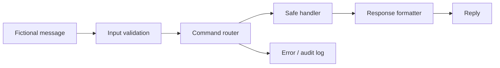

# Telegram Bot as a Python Automation Exercise

This repository contains an **early prototype**, not a hosted or security-audited bot. A bot is an event-driven program that receives input, applies a decision and returns a response.

## Generic architecture

## Useful concepts

| Topic | Why it matters |
|---|---|
| Commands and state | Route help/status actions predictably |
| Async processing | Avoid blocking message handling on slow work |
| Configuration | Keep bot tokens out of code, logs and Git |
| Validation | Reject invalid input without exposing a traceback |
| Rate control | Prevent excessive requests or duplicate processing |
| Logging | Retain error context but not private message contents |
| Tests | Fake update objects and assert handler outcomes |
| Deployment | Separate design, local test, staging and production |

## A safe learning exercise

Write a **pure function** that maps `/help` to a fixed set of fictional commands and unknown input to a clear fallback. Unit-test the function without network access, tokens or real user chats. Only after explicit authorization should a separate environment use a live Telegram Bot API.

## Common misuse

Never commit a real bot token, paste a token into an issue or hardcode a user chat ID in public examples. If a credential may already have been published, rotate it and review Git history under a separate security remediation task.

**RU:** Telegram bot — удобный учебный кейс для асинхронного Python, маршрутизации команд, обработки ошибок и тестов без реальных пользователей.

Reference: [Telegram Bot API](https://core.telegram.org/bots/api), [Python asyncio](https://docs.python.org/3/library/asyncio.html).
